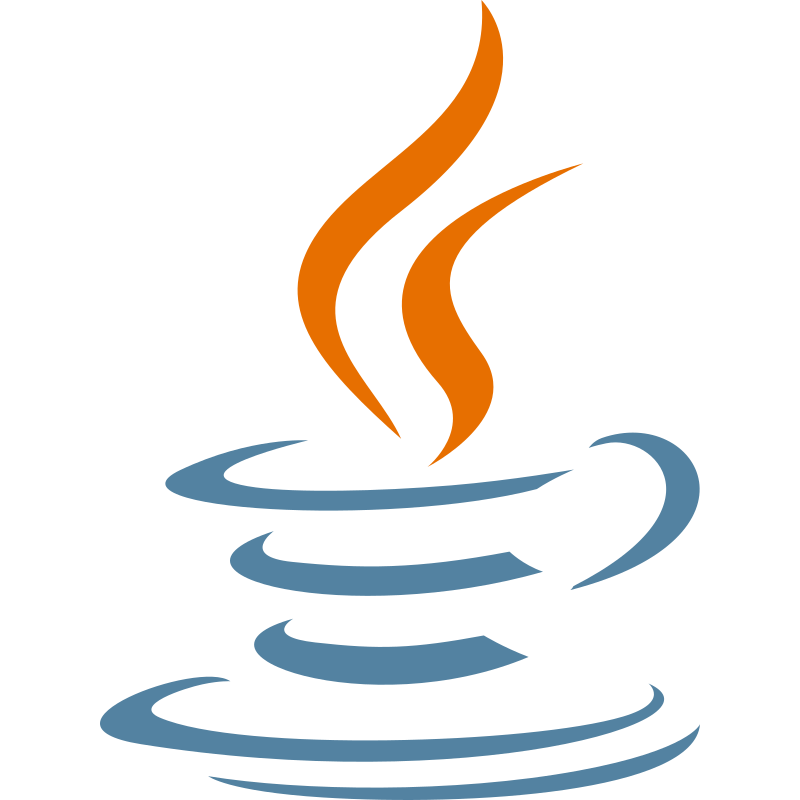
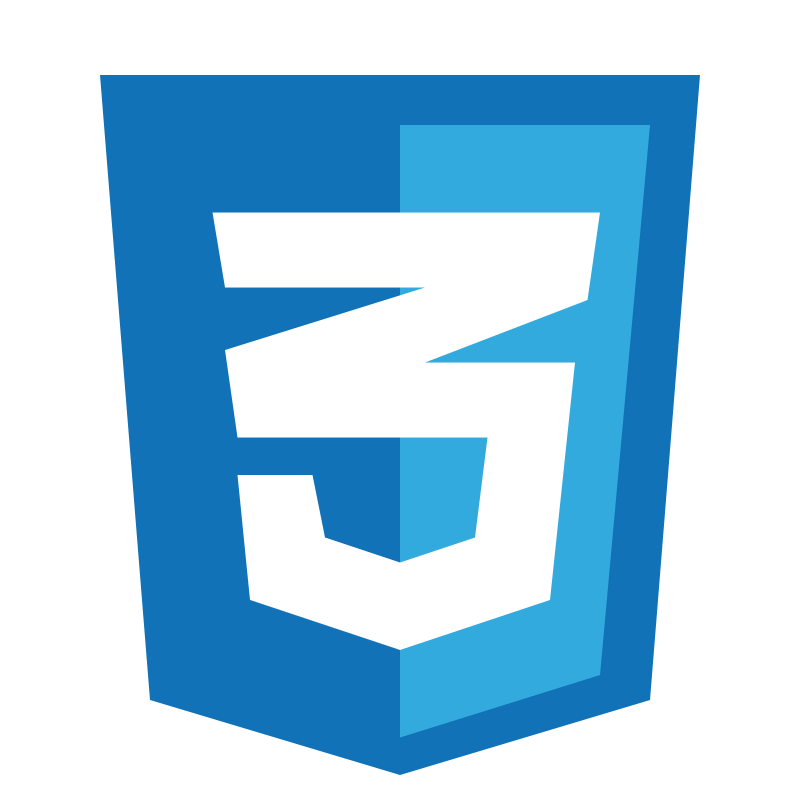
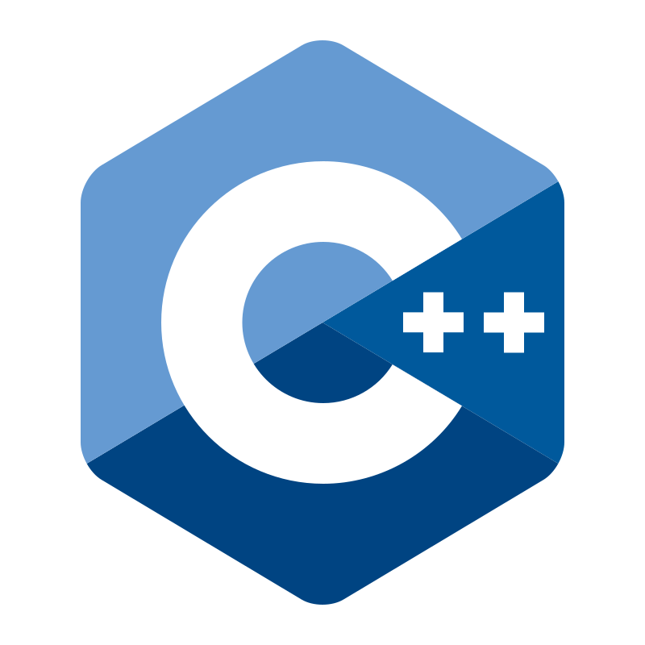
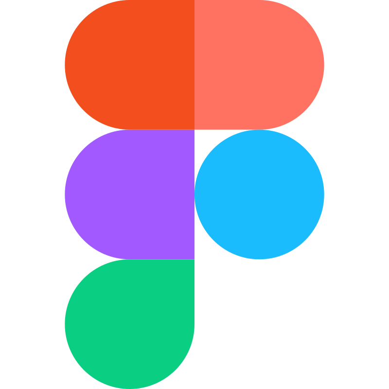

<!-- Apresentação da página -->
# Hello, I'm Letícia Paulino Ferreira
>she / her

Welcome to my GitHub page :tent:

   
<!-- Sobre mim / curiosidades -->
 ### About Me

   Computer Science @ São Carlos Federal University.  
   Passionate about learning, I'm currently focused on exploring cybersecurity and developing my skills in the field. 🔐  
   Outside of tech, I enjoy music 🎼 and collecting Grass-type Pokémon cards! 🍃

### Skills
<!--- Linguagens de programaçãp e modelagem --->

   
   
   
   
   
   
   
   
   
   

<!---Ferramentas --->

   
   
   
   
   
   
   
   
   

### Languages
- Native Brazilian **Portuguese**
- Advanced **English**
- Basic **Spanish**
- Basic **Italian**

### How to reach me 

   
   

*“No matter what anybody tells you, words and ideas can change the world.”*
-- John Keating, Dead Poet’s Society

<!-- Parte que ja veio pronta / feita pelo próprio GitHub -->
   
   <!--- Original
   - 👋 Hi, I’m @Leticia-4lm31d4
   - 👀 I’m interested in ...
   - 🌱 I’m currently learning ...
   - 💞️ I’m looking to collaborate on ...
   - 📫 How to reach me ...
   --->
   
   <!---
   Leticia-4lm31d4/Leticia-4lm31d4 is a ✨ special ✨ repository because its `README.md` (this file) appears on your GitHub profile.
   You can click the Preview link to take a look at your changes.
   --->
